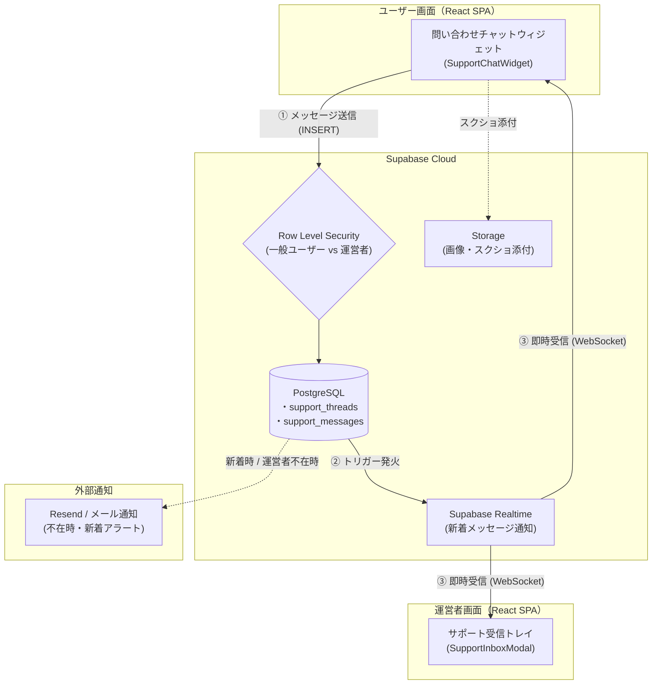

個人開発でWebサービスやSaaSをリリースしたあと、必ず直面するのが**「ユーザーからの問い合わせ・要望をどう受け付けるか？」**という問題です。

本格的なチャットSaaS（Intercom、Zendeskなど）は非常に強力ですが、月額数万円〜と個人開発の規模感にはかなり重い固定費になります。一方で、Googleフォームやメール窓口だけだと「ちょっとした質問やフィードバック」を送るハードルが高く、せっかくの初期ユーザーとの貴重な対話チャンスを逃してしまいがちです。

そこで、筆者が開発・運営しているプロジェクト管理SaaS「[Taski（タスキ）](https://taski-app.com)」では、**Supabase（PostgreSQL + RLS + Realtime）をフル活用し、完全自前の問い合わせチャット基盤**を構築しました。

月額の追加コストは実質0円。それでいて**「アプリ右下のチャットウィジェット」「運営者側の統合受信トレイ（Inbox）」「リアルタイム送受信」「不在時のメール通知」**までを備えた、実戦に耐えうる構成になっています。

本記事では、このチャット基盤の設計思想、DBスキーマ、セキュリティ（RLS）、そして個人開発ならではの運用ハックを余すところなく解説します。

---

## 1. 全体アーキテクチャ

システム構成は非常にシンプルです。追加の常駐サーバーやWebSocketサーバーは一切立てず、すべてSupabaseの標準機能で完結させています。



### なぜ自前実装にしたのか？
1. **圧倒的なコストメリット**: すでにアプリ本体で利用しているSupabaseの枠内に収まるため、追加の月額SaaS費用が0円。
2. **ユーザー情報とのシームレスな結合**: 外部ツールだと「どの組織のどのユーザーか」を特定するためにメタデータの初期化スクリプトが必要ですが、自前なら同一DBなので `profiles` テーブルと結合するだけでプラン、所属プロジェクト、登録日が一瞬で把握できます。
3. **UI/UXの完全な統一**: アプリのデザインシステム（Tailwind CSSやダークモードなど）に自然に溶け込むウィジェットを構築できます。

---

## 2. DB設計：1ユーザー1スレッドと競合対策

### テーブル設計の基本方針
問い合わせチャットは「Slackのような多人数チャンネル」ではなく、**「ユーザーと運営の1対1の対話」**です。そのため、設計を極力シンプルに保つため**「1ユーザーにつき1スレッド（`support_threads`）」**という制約を採用しました。

```sql
-- 1. サポートスレッド（ユーザー1人につき1スレッド）
CREATE TABLE IF NOT EXISTS public.support_threads (
  id UUID PRIMARY KEY DEFAULT gen_random_uuid(),
  user_id UUID NOT NULL UNIQUE REFERENCES auth.users(id) ON DELETE CASCADE,
  status TEXT NOT NULL DEFAULT 'open' CHECK (status IN ('open', 'closed')),
  last_message_at TIMESTAMPTZ,
  last_message_preview TEXT,
  -- 相手側が新着を送ったことを示す未読フラグ
  unread_by_user BOOLEAN NOT NULL DEFAULT false,
  unread_by_operator BOOLEAN NOT NULL DEFAULT false,
  created_at TIMESTAMPTZ NOT NULL DEFAULT now(),
  updated_at TIMESTAMPTZ NOT NULL DEFAULT now()
);

-- 2. サポートメッセージ
CREATE TABLE IF NOT EXISTS public.support_messages (
  id UUID PRIMARY KEY DEFAULT gen_random_uuid(),
  thread_id UUID NOT NULL REFERENCES public.support_threads(id) ON DELETE CASCADE,
  sender_id UUID NOT NULL REFERENCES auth.users(id) ON DELETE CASCADE,
  is_operator BOOLEAN NOT NULL DEFAULT false,
  body TEXT NOT NULL,
  attachments JSONB DEFAULT '[]'::jsonb,
  created_at TIMESTAMPTZ NOT NULL DEFAULT now()
);
```

### ポイント①：`user_id UNIQUE` による安全な find-or-create
ユーザーがチャットを開いた瞬間、スレッドが存在しなければ作成します。しかし、複数タブで開いた場合やボタン連打による競合（Race condition）が起こり得ます。

`user_id` に `UNIQUE` 制約を付与しておくことで、万が一INSERTが重複しても片方がユニーク制約違反で弾かれるため、安全に再取得へフォールバックできます。

```typescript
export async function getOrCreateMyThread(userId: string): Promise<SupportThread | null> {
  if (!isSupabaseConfigured || !supabase) return null;

  // 既存のスレッドがあれば取得
  const { data: existing } = await supabase
    .from('support_threads')
    .select('*')
    .eq('user_id', userId)
    .maybeSingle();
  if (existing) return existing as SupportThread;

  // なければ作成
  const { data: created, error: insertError } = await supabase
    .from('support_threads')
    .insert([{ user_id: userId }])
    .select('*')
    .single();

  if (!insertError && created) return created as SupportThread;

  // ユニーク制約違反（他タブ等で同時に作成された場合）は素直に再取得
  const { data: refetched } = await supabase
    .from('support_threads')
    .select('*')
    .eq('user_id', userId)
    .maybeSingle();

  return (refetched as SupportThread) || null;
}
```

---

## 3. セキュリティ設計：RLSと運営者なりすまし対策

自前実装で最も神経を使うのが**「セキュリティ（Row Level Security）」**です。
「一般ユーザーが他人の問い合わせを盗み見できないこと」はもちろん、**「一般ユーザーが運営者（`is_operator = true`）を名乗って発言できないこと」**をDBレイヤーで厳密に保証する必要があります。

### ① 運営者フラグの自己書き換えを禁止するトリガー
運営者であるかどうかは `profiles.is_site_operator` というBooleanカラムで管理します。しかし、一般的なプロフィール更新ポリシー（`auth.uid() = id`）が有効な場合、クライアントから勝手に `is_site_operator: true` に書き換えられてしまう恐れがあります。

そこで、**「セルフサービス（`auth.uid() IS NOT NULL`）からの変更を例外エラーで弾くトリガー」**を設置します。

```sql
CREATE OR REPLACE FUNCTION public.prevent_operator_self_update()
RETURNS TRIGGER AS $$
BEGIN
  -- ユーザー自身によるセルフサービス更新で is_site_operator が変更された場合はブロック
  IF NEW.is_site_operator IS DISTINCT FROM OLD.is_site_operator AND auth.uid() IS NOT NULL THEN
    RAISE EXCEPTION '運営者フラグはセルフサービスでは変更できません。';
  END IF;
  RETURN NEW;
END;
$$ LANGUAGE plpgsql SECURITY DEFINER;

CREATE TRIGGER trg_prevent_operator_self_update
  BEFORE UPDATE ON public.profiles
  FOR EACH ROW EXECUTE FUNCTION public.prevent_operator_self_update();
```

これにより、運営者権限の付与はSupabaseダッシュボードのSQL Editorやバックオフィス処理（`service_role`）からのみ可能になります。

### ② メッセージ投稿ポリシーでの偽装防止
次に、メッセージのINSERTポリシーです。「自分が送ったメッセージであること」に加え、**「メッセージの `is_operator` フラグが、DB上の本当の `is_site_operator` と完全に一致していること」**を強制します。

```sql
CREATE POLICY "support_messages_insert_policy" ON public.support_messages
  FOR INSERT WITH CHECK (
    -- 送信者は自分自身
    sender_id = auth.uid()
    -- 運営者フラグの自己申告を検証（一般ユーザーが true を送ると拒否される）
    AND is_operator = public.is_site_operator(auth.uid())
    AND (
      -- 運営者なら任意のスレッドに返信可能
      public.is_site_operator(auth.uid())
      -- 一般ユーザーなら自分のスレッド宛てのみ許可
      OR EXISTS (
        SELECT 1 FROM public.support_threads t
        WHERE t.id = support_messages.thread_id AND t.user_id = auth.uid()
      )
    )
  );
```

このポリシーにより、悪意のあるユーザーがブラウザの開発者ツールから直接Supabase APIを叩いて `is_operator: true` を送信しても、PostgreSQL側で確実に弾かれます。

---

## 4. クライアントを信じない：未読・更新の自動トリガー

チャットでは「メッセージが投稿されたら、スレッドの最終更新日時やプレビュー、相手の未読バッジを更新する」必要があります。

これをフロントエンドから「メッセージ送信 ＋ スレッド更新」の2回リクエストで行うと、ネットワーク切断やクラッシュで**「メッセージは届いたのにスレッド一覧の未読がつかない」**という不整合が発生します。

そこで、PostgreSQLの `AFTER INSERT` トリガーでアトミックに同期させます。

```sql
CREATE OR REPLACE FUNCTION public.touch_support_thread_on_message()
RETURNS TRIGGER AS $$
BEGIN
  UPDATE public.support_threads
  SET
    last_message_at = NEW.created_at,
    last_message_preview = left(NEW.body, 200),
    updated_at = now(),
    -- 運営者が送ったならユーザー側を未読に、ユーザーが送ったなら運営者側を未読にする
    unread_by_operator = CASE WHEN NEW.is_operator THEN unread_by_operator ELSE true END,
    unread_by_user = CASE WHEN NEW.is_operator THEN true ELSE unread_by_user END
  WHERE id = NEW.thread_id;
  RETURN NEW;
END;
$$ LANGUAGE plpgsql SECURITY DEFINER;

CREATE TRIGGER trg_touch_support_thread_on_message
  AFTER INSERT ON public.support_messages
  FOR EACH ROW EXECUTE FUNCTION public.touch_support_thread_on_message();
```

クライアントはただメッセージを1行 `INSERT` するだけで、スレッド側のメタデータ管理が完全に保証されます。

---

## 5. 個人開発ならではの運用工夫

### ① 対応完了（closed）後に追記されたら自動で「未解決（open）」に戻す
個人開発では「一度回答してクローズした問い合わせ」に対して、ユーザーが数日後に「追加でここも教えてほしいです！」と返信してくるケースがよくあります。

ステータスが `closed` のままだと運営側の一覧で見落としてしまうため、**一般ユーザーが発言した際は自動的にステータスを `open` に戻す**処理を入れています。

```typescript
// ユーザーが発言した場合は、自動的に未解決（open）へ戻す
if (!isOperator) {
  await supabase
    .from('support_threads')
    .update({ status: 'open' })
    .eq('id', threadId)
    .eq('status', 'closed');
}
```

### ② 常時待機できない問題を解決する「メール通知パイプライン」
個人開発者は専任のカスタマーサポートがいるわけではないため、常時管理画面を見張ることは不可能です。

そのため、ユーザーからメッセージを受信した際は、メール配信API（Resend）をキックして運営者のスマートフォンへ即時メール通知を飛ばします。メール本文には問い合わせプレビューと**「対象スレッドを直接開く管理URL」**を記載しておくことで、移動中でもスマホのブラウザから即座に返信できるようにしています。

---

## 6. まとめ

| 観点 | 外部チャットSaaS | Supabase自前実装 |
| :--- | :--- | :--- |
| **月額コスト** | 数千円〜数万円/月 | **実質0円**（既存DB枠内） |
| **ユーザー情報連携** | 初期化コード・メタデータ同期が必要 | **SQL結合だけでプラン・設定が丸見え** |
| **セキュリティ** | 外部サービスの権限設定に依存 | **PostgreSQL RLSで強固に担保** |
| **UIカスタマイズ** | 埋め込みiframeで制限あり | **Tailwindで完全に自由自在** |

「チャット機能を自作する」と聞くと一見大がかりに思えますが、Supabaseが提供する**「PostgreSQLの信頼性」「RLSによる宣言的セキュリティ」「RealtimeのWebSocket配信」**を組み合わせれば、わずか数本のファイル・数百行のコードで堅牢なチャット基盤が手に入ります。

特に固定費を極限まで抑えたい個人開発フェーズにおいて、このアーキテクチャは非常に強力な選択肢になります。

---

### 💡 Taskiのデモ環境で体験できます
この記事で解説した「問い合わせチャットウィジェット」は、プロジェクト管理SaaS「**[Taski（タスキ）](https://taski-app.com)**」のデモ画面（**会員登録不要・1秒で起動**）で、実際のUIや操作感をそのままお試しいただけます。

画面右下のチャットアイコンをクリックして、スムーズな動作や添付ファイルのやり取りをぜひ触ってみてください！

👉 **[Taski（タスキ）のデモ画面を体験してみる](https://taski-app.com)**
