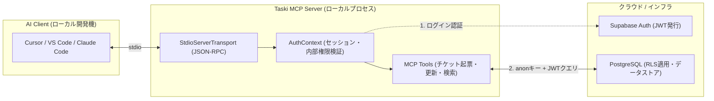

個人開発で Redmine 代替のプロジェクト・課題管理 SaaS「[Taski](https://taski-app.com)」を開発・運用しています。

開発中、こんなストレスを感じたことはないでしょうか？

> 「実装がひと段落したからチケットを完了にしたいけど、ブラウザを開いて、該当プロジェクトを探して、チケットを開いてステータスをドロップダウンで変えて…が地味にめんどくさい」
> 「今、自分にアサインされている未完了タスクって何があったっけ？ エディタから離れずに確認したい」

最近、Cursor や Claude Code などの AI エディタでコーディングする時間が増えたことで、「**ブラウザの管理画面を行き来するコンテキストスイッチ**」が開発効率の最大のボトルネックに感じるようになりました。

そこで、Anthropic が策定したオープン標準プロトコル **MCP (Model Context Protocol)** を使い、**AI アシスタントから自前 SaaS のプロジェクトやチケットを直接検索・起票・更新・工数記録できる公式 MCP サーバー** を TypeScript で自作しました。

今回は、そのアーキテクチャ設計、チュートリアル通りに作ると陥る「**Service Role Key 漏洩のセキュリティ罠と RLS 生存戦略**」、そして「**社内限定ドッグフーディング運用の実装パターン**」についてまとめます。

---

## 1. 何ができるようになったのか？（開発体験のビフォーアフター）

エディタ（Cursor や Claude Code）のチャット欄から、自然言語で指示を出すだけで Taski が自動操作されます。

### 実例①：実装完了時のステータス更新 ＆ 実績工数の加算
```text
ユーザー:
「チケット #142 の実装とテストが終わったので、ステータスを closed にして、実績工数を2時間加算しておいて」

AI アシスタント:
update_ticket ツールを呼び出します:
- ticket_number: 142
- status: "closed"
- add_hours: 2

✔ チケット #142「LPに画像を挿入する」を更新しました（ステータス: closed, 実績工数: 2h 加算完了）。
```

### 実例②：開発中のタスク確認 ＆ 新規チケット起票
```text
ユーザー:
「今抱えている優先度 high のバグチケットを一覧で教えて」

AI アシスタント:
get_tickets ツールを実行しました。未完了の高優先度チケットは以下の2件です:
1. #138: ガントチャートのスクロール同期不具合（期日: 10/24）
2. #140: モバイル表示時のボトムシートのSafe Area調整（期日: 10/25）
```

ブラウザを一切開くことなく、**コーディングの流れ（フロー状態）を保ったままチケット管理が完結** します。

---

## 2. システムアーキテクチャ

MCP は、LLM（クライアント）と外部ツール（サーバー）を JSON-RPC 2.0（標準入出力 `stdio` または SSE）で接続するプロトコルです。



### 技術スタック
- **プロトコル**: `@modelcontextprotocol/sdk` (v1.x)
- **言語・ランタイム**: TypeScript / Node.js
- **スキーマ検証**: Zod
- **バックエンド / BaaS**: Supabase (PostgreSQL + Row Level Security)

---

## 3. 最大の罠：なぜ Service Role Key を捨てたのか？

MCP サーバーの自作記事やサンプルコードを見ていると、バックエンドとの通信に以下のようなコードがよく登場します。

```typescript
// ⚠ よくあるアンチパターン
const supabase = createClient(SUPABASE_URL, SUPABASE_SERVICE_ROLE_KEY);
```

Supabase の `Service Role Key`（サービスロールキー）は、**PostgreSQL の Row Level Security (RLS) を完全にバイパスし、全テーブル・全テナントの読み書きを無条件で許可する特権マスターキー** です。

サーバーサイドのバッチ処理や Webhook ハンドラで使う分には問題ありませんが、**MCP サーバーでこれを使うのは非常に危険** です。

### 危険な理由
1. **MCP サーバーは開発者のローカルマシンで動く**:
   設定ファイル（`.cursor/mcp.json` や `.env`）に特権キーを平文で保存することになり、Git への誤コミットやローカル端末紛失時の被害半径が壊滅的になります。
2. **AI が意図しない全テナントのデータを破壊・漏洩するリスク**:
   LLM がツールの引数を誤解して `DELETE FROM tickets` を実行した場合、Service Role Key だと他社の本番データまで一瞬で消滅します。

### 解決策：ユーザー認証（JWT）＋ PostgreSQL RLS の徹底

Taski の MCP サーバーでは、Service Role Key を一切使わず、**開発者の Taski アカウント（メール＆パスワード）で起動時にサインインする設計** にしました。

```typescript
// packages/taski-mcp/src/auth.ts より抜粋
export async function authenticate(): Promise<AuthContext> {
  const email = process.env.TASKI_EMAIL;
  const password = process.env.TASKI_PASSWORD;

  if (!email || !password) {
    throw new Error('TASKI_EMAIL と TASKI_PASSWORD を設定してください。');
  }

  // 公開鍵（anon key）でクライアントを作成
  const client = createClient(SUPABASE_URL, SUPABASE_ANON_KEY, {
    auth: { persistSession: false, autoRefreshToken: false },
  });

  // 開発者自身のアカウントで認証
  const { data: authData, error: authError } = await client.auth.signInWithPassword({
    email,
    password,
  });

  if (authError || !authData.user) {
    throw new Error(`ログイン失敗: ${authError?.message}`);
  }

  // 社内アカウント (profiles.plan === 'internal') の検証
  const { data: profile } = await client
    .from('profiles')
    .select('id, full_name, plan, is_site_admin')
    .eq('id', authData.user.id)
    .single();

  if (profile?.plan !== 'internal') {
    throw new Error('MCPサーバーは社内アカウント限定機能です。');
  }

  return {
    client, // 以後のクエリはこの client（ユーザーのJWT付き）で行う
    userId: authData.user.id,
    userEmail: email,
    isInternal: true,
    isSiteAdmin: Boolean(profile.is_site_admin),
  };
}
```

この設計により、以下の絶大なメリットが得られます：
- **Row Level Security (RLS) が 100% 適用される**:
  AI アシスタントがどのようなツール呼び出しを行っても、**ログインした開発者が参加しているプロジェクトのデータ以外は物理的に参照・更新できません**。
- **監査ログ（Created By / Updated By）が正確に残る**:
  誰が AI 経由でタスクを作ったのかが、`auth.uid()` を通じて自然に記録されます。

---

## 4. MCP 実装でハマった 2 つの注意点

### ① stdio 通信時の `console.log` 厳禁（JSON-RPC 破壊の罠）

MCP のローカル通信は、標準入出力（`stdio`）を介して JSON-RPC 形式でメッセージをやり取りします。

```typescript
// ❌ やってはいけない（JSON-RPC メッセージが汚染されてエディタ側がクラッシュする）
console.log('Fetching tickets for project:', projectId);

// ⭕ デバッグログは必ず stderr（標準エラー出力）へ流す
console.error('[taski-mcp] Fetching tickets for project:', projectId);
```

`console.log` を1行でも実行してしまうと、クライアント（Cursor）側が「壊れた JSON-RPC レスポンスを受信した」と判定してサーバー接続を切断してしまいます。デバッグログや接続通知は **必ず `console.error` を使用する** のが鉄則です。

### ② Zod スキーマによる引数の明示と、自然言語の「ゆらぎ」吸収

AI は時として、プロジェクトIDに UUID ではなく「プロジェクト名（例: バグ報告）」を渡してきたり、ステータスに「完了」という日本語を入れてきたりします。

ツール側のヘルパーで、このゆらぎを自然に吸収できるように設計しました。

```typescript
// プロジェクト指定のゆらぎ吸収（UUIDでもプロジェクト名でもOKにする）
export async function resolveProjectId(
  auth: AuthContext,
  projectIdOrName?: string
): Promise<string> {
  const { data: projects } = await auth.client.from('projects').select('id, name');

  if (!projectIdOrName) {
    // 未指定時は直近のプロジェクトを自動選択
    return projects[0].id;
  }

  // 1. 完全一致するUUIDか？
  const byId = projects.find((p) => p.id === projectIdOrName);
  if (byId) return byId.id;

  // 2. プロジェクト名での部分一致・あいまい検索
  const byName = projects.find((p) =>
    p.name.toLowerCase().includes(projectIdOrName.toLowerCase())
  );
  if (byName) return byName.id;

  throw new Error(`プロジェクト「${projectIdOrName}」が見つかりませんでした。`);
}
```

これにより、ユーザーが「バグ報告プロジェクトにチケット作って」とラフに指示しても、AI が迷わず正しい ID を解決してくれます。

---

## 5. まとめ

個人開発 SaaS における MCP サーバーの自作は、単なる「流行りの機能追加」ではなく、**開発者自身のドッグフーディング体験（DX）を別次元に引き上げるキラー機能** でした。

- **ブラウザへの画面切り替えゼロ**: コーディングしながら会話感覚でチケット管理
- **Service Role Key ではなく RLS を貫く**: ローカルで動かすからこそ、セキュリティの原則を守る
- **AI のゆらぎをツール側で吸収**: 名前検索や自動フォールバックで使い心地を最大化

AI エディタが開発の主戦場になりつつある今、自社の Web サービスに MCP サーバーを生やすアプローチは非常におすすめです。

---

### 💡 Taski のデモ環境について
この記事で紹介したタスク管理 SaaS「Taski」は、Redmine 移行や軽量カンバン・ガントチャートに対応したチーム向けツールです。**登録不要・1秒で起動する Web デモ** を公開していますので、軽快な操作感をぜひ体感してみてください。

👉 [**Taski のデモをブラウザで試す（登録不要・1秒起動）**](https://taski-app.com)
