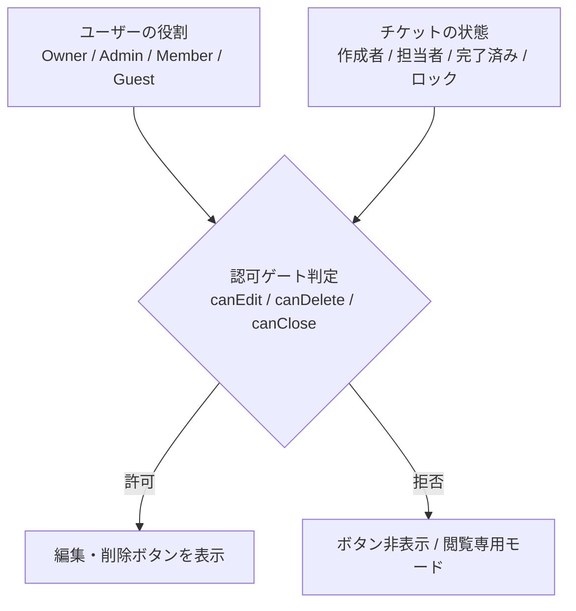

個人開発で Redmine / Backlog 代替のプロジェクト・課題管理 SaaS「[Taski（タスキ）](https://taski-app.com)」を開発・運用しています。

個人開発の初期フェーズにおいて、よく耳にするのが 「**一人で作っているうちはテストコードを書く暇があったら新機能を実装しろ**」「**自分で画面を触れば十分**」 という言説です。

筆者もリリース当初はその方針でした。Vite + React + TypeScript + Supabase というモダンなスタックで、とにかく爆速で機能を作り、手動で動作確認をして本番リリースを繰り返していました。

しかし、リリースから半年が経ち、ユーザーが増え、機能が拡張されるにつれて、「**ここだけは絶対に壊してはいけない。手動テストではもう限界だ**」 という2つの急所（アキレス腱）に直面することになりました。

それが、
1. **他ツール（Redmine / Backlog / Trello）からの CSV 移行パーサー**
2. **多階層なロールとチケット状態が掛け合わさる認可ゲート（権限ロジック）**

です。

今回は、テストが1件もなかった個人開発 SaaS に **Vitest** を導入し、この「壊れたら即座にユーザー離脱・信頼失墜に繋がるコアロジック」を148件の単体テストで鉄壁に固めた設計と実践知見を共有します。

---

## 1. なぜ「テスト不要論」を撤回したのか？（壊れたら死ぬ2大領域）

### ① CSVインポート：集客の生命線（失敗＝0秒で即離脱）
Taski の最大の集客の入口は「Redmine や Backlog からの CSV 移行」です。
ユーザーは既存ツールから数千件のチケットを CSV に書き出し、Taski にドラッグ＆ドロップして移行を試します。

ここでパースエラーが起きたり、文字化けしたり、チケットの親子関係や担当者がズレたりしたらどうなるでしょうか？
ユーザーは二度と戻ってきません。「**動かないツール**」という印象を残して0秒で離脱します。

しかし、実世界から送られてくる CSV はまさに「怪文書の宝庫」です。
- セル内に改行やカンマが大量に含まれている
- 二重引用符（ダブルクォート）のエスケープ（`""`）
- 日付フォーマットの揺らぎ（`YYYY-MM-DD`, `YYYY/MM/DD`, `M/D/YYYY`）
- 同姓同名のユーザーや、姓だけ（「田中」）のアサイン表記
- Excel由来のBOM付きUTF-8やShift-JIS

新機能のためにパーサーに少し手を入れるたびに、「過去に対応したあの特殊なCSVが動かなくなっていないか…？」と冷や汗をかきながら手動確認する運用は、明らかに限界を迎えていました。

### ② 認可ゲート（権限ロジック）：組み合わせの爆発
もう一つの急所が権限判定です。
Taski には「オーナー」「管理者（admin）」「一般メンバー（member）」「閲覧専用（guest）」、さらに「ログイン不要の仮メンバー」というロールが存在します。

これにチケットの状態が掛け合わさります。
- 自分が作成したチケットか？
- 自分が担当者にアサインされているか？
- すでに「完了（クローズ）」しているか？
- 親チケットか、サブタスクか？



バックエンド（Supabase RLS）で不正操作をブロックしているとはいえ、フロントエンドの認可判定がバグると、
- 「編集できるはずの担当者が、なぜか期日を変更できない」
- 「閲覧専用ゲストに一瞬だけ削除ボタンが見えてしまい、押すと403エラーになる」
といった最悪のユーザー体験を引き起こします。この「掛け算のパターン」を手動で全件チェックするのは不可能です。

---

## 2. なぜ Jest ではなく Vitest なのか？

フロントエンドのテストといえば長年 Jest がデファクトでしたが、Vite で構築されたモダンな SPA においては **Vitest 一択** でした。理由は極めてシンプルです。

1. **`vite.config.ts` の設定（エイリアス・プラグイン）がそのまま共有できる**
   Jest を導入しようとすると、Babel の設定、`ts-jest` の設定、`tsconfig.json` のパスエイリアス解決（`@/components` など）を別々に二重定義する必要があり、環境構築だけで半日溶けます。Vitest なら `vite.config.ts` に数行足すだけで完了します。
2. **実行速度が圧倒的（TypeScriptの再トランスパイル不要）**
   Vite の内部トランスパイラ（esbuild）を使うため、立ち上げと実行が一瞬です。140件以上のテストが **2〜4秒** で全件走ります。
3. **Jest互換のAPI**
   `describe`, `it`, `expect`, `vi.fn()` など、使い慣れた Jest とほぼ同一の書き方ができます。

### 導入手順（設定ファイル）

導入は以下のパッケージを追加するだけです。

```bash
npm install -D vitest @testing-library/react @testing-library/jest-dom jsdom
```

`vite.config.ts` にテスト設定を追加します。

```typescript:vite.config.ts
import { defineConfig } from 'vite';
import react from '@vitejs/plugin-react';

export default defineConfig({
  plugins: [react()],
  test: {
    globals: true,
    environment: 'jsdom',
    setupFiles: './src/test/setup.ts',
    include: ['src/**/*.{test,spec}.{ts,tsx}'],
  },
});
```

`src/test/setup.ts` で DOM マッチャーを拡張します。

```typescript:src/test/setup.ts
import '@testing-library/jest-dom';
```

これだけで、`npx vitest run` を叩けば即座にテストが走る環境が完成します。

---

## 3. 実践①：怪文書CSVに耐えるパーサーの単体テスト

まずは最大の難所である CSV パーサーのテストです。
Redmine の CSV エクスポートは、チケット詳細の本文に改行や Markdown の表、引用符が含まれるため、単に `split('\n')` や `split(',')` をするナイーブな実装では確実に粉砕されます。

### 二重引用符と改行のハンドリング
RFC 4180 に準拠したパース処理が正しく動いているかをテストで網羅します。

```typescript:src/lib/__tests__/redmineCsvParser.test.ts
import { describe, it, expect } from 'vitest';
import { parseRedmineCsv } from '../redmineCsvParser';

describe('parseRedmineCsv', () => {
  it('セル内の改行とエスケープされたダブルクォートを正しくパースできること', () => {
    const csv = [
      '#,"題名","説明","ステータス"',
      '1,"バグ報告","1行目\n2行目\n""ダブルクォートで囲まれた文字列""を含む本文","新規"',
      '2,"通常タスク","単一引用符 \'テスト\'","進行中"',
    ].join('\n');

    const result = parseRedmineCsv(csv);

    expect(result.tickets).toHaveLength(2);
    expect(result.tickets[0].description).toBe(
      '1行目\n2行目\n"ダブルクォートで囲まれた文字列"を含む本文'
    );
    expect(result.tickets[1].description).toBe("単一引用符 'テスト'");
  });

  it('末尾の空行や余計な改行コード（CRLF）が混ざっていてもクラッシュしないこと', () => {
    const csv = "#,題名,ステータス\r\n10,タスクA,新規\r\n\r\n\r\n";
    const result = parseRedmineCsv(csv);
    expect(result.tickets).toHaveLength(1);
    expect(result.tickets[0].title).toBe('タスクA');
  });
});
```

### 担当者マッピングの曖昧さ回避
CSV に書かれた担当者名から既存メンバーを解決するロジックもテスト化しました。
特にハマりやすいのが 「**同姓同名のメンバーが存在する場合**」 です。

以前の実装では、CSV に「田中」とだけ書かれていた際、プロジェクト内に「田中 太郎」「田中 次郎」がいた場合に**先頭の1人を勝手に選んでアサインしてしまう**というサイレントな誤爆バグが潜んでいました。

テストを書くことで、
- 完全一致（氏名フルネーム）なら自動アサイン
- 同姓が複数いて特定不能な場合は、勝手に割り振らず「未未定（要確認）」として抽出し、画面側で選択モーダルを出す

という安全な仕様へとリファクタリングし、テストでその振る舞いを保証できるようになりました。

---

## 4. 実践②：認可ゲートの網羅マトリクステスト

次に、権限判定ロジック（`src/lib/permissions.ts`）のテストです。
コンポーネント内にインラインで権限チェックを書くのをやめ、「**純粋関数（Pure Function）**」 として切り出しておくことで、テストが驚くほど簡単かつ高速になります。

```typescript:src/lib/permissions.ts
// 外部依存のない純粋関数として定義
export const canEditTicket = (
  user: UserProfile | null,
  memberRole: ProjectMemberRole | null,
  ticket: Ticket
): boolean => {
  if (!user || !memberRole) return false;
  if (memberRole === 'owner' || memberRole === 'admin') return true;
  if (memberRole === 'guest') return false;

  // 一般メンバーは「自分が作成したチケット」または「担当チケット」のみ編集可能
  const isCreator = ticket.created_by === user.id;
  const isAssignee = ticket.assignee_ids?.includes(user.id);
  return isCreator || isAssignee;
};
```

この純粋関数に対して、ロールとチケット状態のマトリクステストを書きます。

```typescript:src/lib/__tests__/permissions.test.ts
import { describe, it, expect } from 'vitest';
import { canEditTicket, canDeleteTicket } from '../permissions';

describe('チケット認可ゲートのテスト', () => {
  const mockUser = { id: 'user-1', name: '一般太郎' };
  const baseTicket = { id: 't-1', created_by: 'user-999', assignee_ids: [] };

  describe('canEditTicket', () => {
    it('管理者（admin）は他人が作ったチケットでも編集できること', () => {
      expect(canEditTicket(mockUser, 'admin', baseTicket)).toBe(true);
    });

    it('一般メンバーは無関係なチケットを編集できないこと', () => {
      expect(canEditTicket(mockUser, 'member', baseTicket)).toBe(false);
    });

    it('一般メンバーでも担当者に含まれていれば編集できること', () => {
      const assignedTicket = { ...baseTicket, assignee_ids: ['user-1'] };
      expect(canEditTicket(mockUser, 'member', assignedTicket)).toBe(true);
    });

    it('ゲスト（guest）は担当者であっても編集できないこと', () => {
      const assignedTicket = { ...baseTicket, assignee_ids: ['user-1'] };
      expect(canEditTicket(mockUser, 'guest', assignedTicket)).toBe(false);
    });
  });

  describe('canDeleteTicket', () => {
    it('チケットの削除は作成者本人または管理者のみ許可されること', () => {
      expect(canDeleteTicket(mockUser, 'member', baseTicket)).toBe(false);
      expect(canDeleteTicket(mockUser, 'member', { ...baseTicket, created_by: 'user-1' })).toBe(true);
      expect(canDeleteTicket(mockUser, 'admin', baseTicket)).toBe(true);
    });
  });
});
```

このテストの実行時間はわずか **4ミリ秒** です。
画面を立ち上げて、ユーザーを切り替えて、ログアウトして、ボタンの有無を目視確認していた作業が、4ミリ秒で100%確実に検証できるようになりました。

---

## 5. テストを導入して得られた3つの劇的な変化

テストコードが0件だった状態から、主要コアロジックに Vitest を導入して実感したメリットは以下の3点です。

### 1. リファクタリングの恐怖が完全に消えた
これが最も大きな変化です。「パーサーを高速化したい」「正規表現を綺麗にしたい」と思った時、以前なら「どこかが壊れるかもしれないから触らないでおこう…」と技術的負債を放置していました。
いまは **`npx vitest run` を叩いてグリーンになれば安心** してプッシュできます。

### 2. 「仕様書」がテストコードとして残る
「同姓同名のときはどうするんだっけ？」「ゲスト権限ってコメント編集できたっけ？」という仕様の迷いが、テストケースを見れば一瞬でわかるようになりました。個人開発では未来の自分は他人です。3ヶ月後の自分が仕様を思い出すための最高のドキュメントになります。

### 3. バグ報告が来たときの調査が圧倒的に速い
ユーザーから「このCSVが取り込めない」「保存したのに警告が出る」という報告を受けた際、そのデータをそのままテストケースにコピペして `it('再現テスト')` を作れば、手元で即座に赤（Red）を再現できます。修正して緑（Green）になったら完了です。

---

## 6. まとめ：個人開発だからこそ「急所」にだけテストを書く

個人開発において、カバレッジ100%を目指してUIの隅々までテストを書くのはリソース的に現実的ではありません。

しかし、
- **壊れたら集客が死ぬ機能（CSVインポート、データ移行）**
- **組み合わせが多く手動チェックが破綻する機能（認可判定、日付・期間計算）**

という 「**プロダクトの急所（Core Domain）**」 に絞って Vitest を導入することは、開発スピードを落とすどころか、むしろ**手動確認の時間を劇的に削り、将来の開発速度をブースト**してくれます。

Vite を使っているプロジェクトなら、Vitest は設定10分で走り出せます。まだテストを書いていない方は、まず一番バグりやすいユーティリティ関数1つから試してみてはいかがでしょうか。

---

### 実装したプロダクトに触れてみたい方へ
今回紹介した「怪文書CSVも安全に取り込めるインポート機能」や「サクサク動くタスク管理UI」は、筆者が開発している **[Taski（タスキ）](https://taski-app.com)** のデモ環境で今すぐ無料・登録不要でお試しいただけます。

👉 [**Taski のデモを1秒で体験してみる（登録不要）**](https://taski-app.com/?demo=true)
