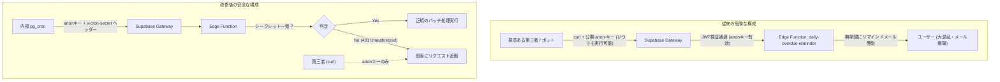

個人開発で Redmine / Backlog 代替のプロジェクト・課題管理 SaaS「[Taski（タスキ）](https://taski-app.com)」を開発・運用しています。

Supabase の **Edge Functions**（Deno ランタイム）は、モダンな個人開発 SaaS にとって無くてはならない強力な武器です。Webhook の非同期処理、Resend を使ったメール通知、`pg_cron` と組み合わせた期日リマインドや定期タスクの自動生成など、サーバーレスで爆速にバックエンド機能を構築できます。

しかし、運用を続ける中で、**「Supabase のデフォルト Gateway（JWT認証）を通しているから安全」と過信していたために潜んでいた、複数の重大なセキュリティ落とし穴** に直面しました。

放置すれば、
- **公開 anon キーさえあれば、第三者が無制限に全社リマインドメールを発砲できる**
- **メール送信エンドポイントが、悪意あるスパムやフィッシングの踏み台（オープンメールリレー）にされる**
- **Webhook 送信機能が悪用され、クラウド内部ネットワークを偵察される（SSRF）**

という致命的な事故に繋がりかねない状態でした。

今回は、個人開発 SaaS の本番運用で見落としがちな **Edge Functions の 3 大セキュリティ脆弱性と、それを Deno + PostgreSQL で鉄壁に塞いだ実践的な設計パターン** を共有します。

---

## 1. 落とし穴①：pg_cron 定時バッチの「認証バイパス」

### 発生していた問題
Taski では、毎日朝 8:00 に「期日切れチケットの一覧」を各担当者へ通知する定時リマインドバッチを運用しています。
PostgreSQL の拡張機能である `pg_cron` と `pg_net` を使い、定刻に Edge Function `daily-overdue-reminder` を HTTP POST する構成です。

```sql
-- 従来の pg_cron 設定
SELECT cron.schedule(
  'daily_overdue_reminder_job',
  '0 23 * * *', -- UTC 23:00 (JST 8:00)
  $$
  SELECT net.http_post(
    url:='https://[PROJECT_REF].supabase.co/functions/v1/daily-overdue-reminder',
    headers:='{"Content-Type": "application/json", "Authorization": "Bearer [ANON_KEY]"}'::jsonb,
    body:='{}'::jsonb
  );
  $$
);
```

一見、`Authorization: Bearer [ANON_KEY]` を付与しているため、認証されているように見えます。
しかし、**`ANON_KEY` はフロントエンド（ブラウザ）に公開されている公開鍵** です。誰でもブラウザの開発者ツールを見れば取得できます。

Supabase Gateway は「有効な JWT（anon キーを含む）が付いているか」だけを検査するため、**悪意ある第三者が curl やスクリプトで anon キーを添えてこの URL を叩くだけで、いつでも・何百回でも全ユーザー宛てのリマインドメールを強制発砲できてしまう** 状態でした。



### 解決策：`x-cron-secret` による内部認可ガード
外部からの直接実行を拒絶し、DB 内部の `pg_cron` からの呼び出しのみを許可するため、**Edge Function Secrets と `pg_cron` の間で共有する専用のシークレットトークン（`CRON_SECRET`）** を導入しました。

```typescript
// supabase/functions/daily-overdue-reminder/index.ts
import { serve } from "https://deno.land/std@0.168.0/http/server.ts";

serve(async (req) => {
  if (req.method === "OPTIONS") {
    return new Response("ok", { headers: corsHeaders });
  }

  // 内部Cronジョブの共有シークレット検証
  const cronSecret = Deno.env.get("CRON_SECRET") || "";
  const providedSecret = req.headers.get("x-cron-secret") || "";

  if (!cronSecret || providedSecret !== cronSecret) {
    return new Response(JSON.stringify({ error: "Unauthorized" }), {
      status: 401,
      headers: { "Content-Type": "application/json" },
    });
  }

  // ここから先は正規の cron からの呼び出しのみが実行される
  // ...
});
```

`pg_cron` 側の設定も、このヘッダーを注入する形に改修します：

```sql
SELECT cron.schedule(
  'daily_overdue_reminder_job',
  '0 23 * * *',
  $$
  SELECT net.http_post(
    url:='https://[PROJECT_REF].supabase.co/functions/v1/daily-overdue-reminder',
    headers:=jsonb_build_object(
      'Content-Type', 'application/json',
      'Authorization', 'Bearer [ANON_KEY]',
      'x-cron-secret', '[強力なランダムシークレット]'
    ),
    body:='{}'::jsonb
  );
  $$
);
```

これで、公開 anon キーが漏洩していても、外部からの不正呼び出しは 100% 401 Unauthorized で遮断されるようになりました。

---

## 2. 落とし穴②：メール送信 Function の「オープンメールリレー化」

### 発生していた問題
チケット作成やステータス変更時、通知メールを送るための汎用関数 `send-email` を用意していました。
当初の実装では、クライアントから以下のような JSON を受け取っていました：

```json
{
  "to": "user@example.com",
  "subject": "チケットが更新されました",
  "html": "<p>内容...</p>"
}
```

このエンドポイントはログインユーザーの JWT を検証していましたが、**「宛先（to）と本文（html）をクライアントが自由に指定できる」** という致命的な欠陥がありました。

ログインさえしてしまえば、悪意あるユーザーがスクリプトを組み、Taski の送信元ドメイン（Resend の DKIM / SPF 設定済みドメイン）を使って、**世界中の全く関係ないメールアドレス宛てに詐欺・フィッシングメールを大量送信できる「オープンメールリレー」** として悪用できてしまう状態でした。

### 解決策：宛先・本文の「自由入力」を完全剥奪
クライアントから「宛先メールアドレス」や「生の HTML」を直接受け取るのを完全に廃止しました。

1. **送信先は `project_id` に実在するメンバーのみに制限**
2. **テンプレート ID とパラメータのみを受け取り、HTML はサーバー側で生成**
3. **未ログインユーザーからの直接呼び出しは 401 で遮断**

```typescript
// supabase/functions/send-email/index.ts
serve(async (req) => {
  // 1. ユーザーセッション（JWT）の検証
  const authHeader = req.headers.get("Authorization");
  const { data: { user }, error: authError } = await supabase.auth.getUser(
    authHeader?.replace("Bearer ", "")
  );
  if (authError || !user) {
    return new Response(JSON.stringify({ error: "Unauthorized" }), { status: 401 });
  }

  const { projectId, recipientUserId, templateKey, params } = await req.json();

  // 2. 送信先ユーザーが対象プロジェクトのメンバーであるかを検証（部外者への送信を防止）
  const { data: membership } = await supabaseAdmin
    .from("project_members")
    .select("role, profiles(email, full_name)")
    .eq("project_id", projectId)
    .eq("user_id", recipientUserId)
    .single();

  if (!membership || !membership.profiles?.email) {
    return new Response(JSON.stringify({ error: "Invalid recipient in project" }), { status: 403 });
  }

  // 3. サーバー定義の安全なテンプレートからHTMLを生成（任意HTMLの注入を防止）
  const htmlContent = renderEmailTemplate(templateKey, params);

  // 4. 検証された正式な宛先へ送信
  await sendViaResend({
    to: membership.profiles.email,
    subject: renderSubject(templateKey, params),
    html: htmlContent,
  });
});
```

この設計により、万が一クライアントが改ざんされても、プロジェクト外の第三者へ勝手にメールが送信されるリスクをゼロに抑え込みました。

---

## 3. 落とし穴③：カスタム Webhook の「SSRF（サーバー側リクエスト偽造）」

### 発生していた問題
Taski には、チケットの更新イベントをチームの外部システム（Slack, Discord, 独自サーバー等）へ通知する「Webhook 送信機能」があります。
ユーザーが設定画面で入力した URL に対し、Edge Function `send-webhook` がペイロードを HTTP POST します。

ここで問題になるのが **SSRF（Server-Side Request Forgery）** です。
もしユーザーが Webhook URL に以下のような値を登録したらどうなるでしょうか？

- `http://169.254.169.254/latest/meta-data/`（クラウドインスタンスのメタデータサービス）
- `http://localhost:5432/` または `http://127.0.0.1/`（内部ループバック）
- `http://10.0.0.1/` や `http://192.168.1.1/`（プライベートネットワーク内の機器）

Edge Function の実行コンテナから内部ネットワーク宛てにリクエストが飛んでしまい、内部情報の漏洩や不正アクセスの足がかりにされてしまいます。

### 解決策：厳格な URL スキーム・IP アドレス検証
Webhook 送信を行う前に、URL をパースし、危険なスキームや内部 IP アドレス宛てのリクエストを即座にブロックするバリデーションを導入しました。

```typescript
// supabase/functions/send-webhook/index.ts
function isSafeWebhookUrl(rawUrl: string): boolean {
  try {
    const parsed = new URL(rawUrl);

    // 1. https のみを許可（平文 http や file://, gopher:// 等を拒否）
    if (parsed.protocol !== "https:") {
      return false;
    }

    const hostname = parsed.hostname.toLowerCase();

    // 2. ローカルホスト・ループバックの拒否
    if (
      hostname === "localhost" ||
      hostname.endsWith(".localhost") ||
      hostname === "127.0.0.1" ||
      hostname === "::1"
    ) {
      return false;
    }

    // 3. クラウドメタデータアドレス（169.254.x.x）の拒否
    if (hostname.startsWith("169.254.") || hostname === "metadata.google.internal") {
      return false;
    }

    // 4. プライベート IP 帯（RFC 1918）の拒否
    const ipv4Regex = /^(\d{1,3})\.(\d{1,3})\.(\d{1,3})\.(\d{1,3})$/;
    const match = hostname.match(ipv4Regex);
    if (match) {
      const [_, o1, o2] = match.map(Number);
      if (o1 === 10) return false; // 10.0.0.0/8
      if (o1 === 172 && o2 >= 16 && o2 <= 31) return false; // 172.16.0.0/12
      if (o1 === 192 && o2 === 168) return false; // 192.168.0.0/16
      if (o1 === 0 || o1 >= 224) return false; // マルチキャスト・予約アドレス
    }

    return true;
  } catch {
    return false;
  }
}
```

このチェックを通過しない URL への Webhook 送信は即時スキップし、活動ログに警告を記録するようにしました。

---

## 4. バッチの信頼性向上：二重送信を防ぐ「クレームテーブル」設計

セキュリティと同時に直面したのが、**「定時バッチが同日に複数回走った場合の二重送信事故」** です。
手動テストやネットワーク瞬断時の自動リトライ等でバッチが同日中に 2 回実行されると、同じユーザーへ「期日切れチケットのお知らせ」が重複して届いてしまいます。

これを防ぐため、送信履歴を記録する専用テーブル `cron_reminder_sends` を新設しました：

```sql
CREATE TABLE IF NOT EXISTS public.cron_reminder_sends (
  id uuid PRIMARY KEY DEFAULT gen_random_uuid(),
  kind text NOT NULL CHECK (kind IN ('overdue', 'stale')),
  project_id uuid NOT NULL REFERENCES public.projects(id) ON DELETE CASCADE,
  user_id uuid NOT NULL REFERENCES auth.users(id) ON DELETE CASCADE,
  sent_date date NOT NULL,
  sent_at timestamptz NOT NULL DEFAULT timezone('utc', now()),
  -- 同一プロジェクト・同一ユーザー・同一種別・同一日付での重複をDBレベルで弾く
  UNIQUE (kind, project_id, user_id, sent_date)
);

-- service_role（Edge Function）のみが読み書きするため、RLSは有効のままポリシー無し
ALTER TABLE public.cron_reminder_sends ENABLE ROW LEVEL SECURITY;
```

Edge Function 側では、メールを送信する **直前** にこのテーブルへ INSERT を試みます。

```typescript
// 送信前に「送信権（クレーム）」を獲得する
const { error: claimError } = await supabaseAdmin
  .from("cron_reminder_sends")
  .insert({
    kind: "overdue",
    project_id: ticket.project_id,
    user_id: user.id,
    sent_date: todayStr, // YYYY-MM-DD
  });

if (claimError) {
  // UNIQUE制約違反（23505）なら、今日すでに送信済みなのでスキップ
  if (claimError.code === "23505") {
    console.log(`Skipping: user ${user.id} already received overdue reminder today.`);
    continue;
  }
}

// クレーム獲得に成功した時だけ実際にメール送信
await sendOverdueEmail(user, tickets);
```

メモリ上のフラグではなく、データベースのユニーク制約をセマフォ（排他制御）として使うことで、**並行実行や二重トリガーが起きても絶対に同じメールが2通届かない冪等（べきとう）なバッチ処理** が完成しました。

---

## まとめ：BaaS時代の「見えない境界線」を守る

Supabase のような BaaS（Backend as a Service）は、インフラの面倒な運用から開発者を解放してくれる素晴らしいプラットフォームです。
しかし、**「クライアントから直接呼ばれるエッジ」と「内部バッチからのみ呼ばれるエッジ」の境界線** は、開発者自身が明確に意識してガードを実装しなければなりません。

今回導入したチェックリスト：
- [x] **pg_cron や内部専用の Function には共有シークレット（`x-cron-secret`）を設けているか？**
- [x] **メール送信エンドポイントが、任意宛先・任意本文のオープンリレーになっていないか？**
- [x] **ユーザー入力の Webhook URL に対して SSRF（プライベートIP宛て送信）対策をしているか？**
- [x] **バッチ処理はリトライや手動実行に耐えうる冪等性（二重送信防止）を備えているか？**

個人開発だからこそ、リリース後の「セキュリティ事故による信頼失墜」は致命傷になります。
同じように Supabase Edge Functions を活用されている方の参考になれば幸いです。

---

### 実際に動いているプロダクト
この記事で解説したセキュリティ設計と堅牢なバックエンドは、Redmine / Backlog 代替のタスク管理 SaaS **「Taski（タスキ）」** の本番環境で実際に稼働しています。

ログイン不要・1秒で立ち上がるデモ画面で、サクサク動くプロジェクト管理を体験できますので、ぜひ触ってみてください！

👉 **[Taski（タスキ）を登録不要のデモで試す](https://taski-app.com/?demo=true)**
