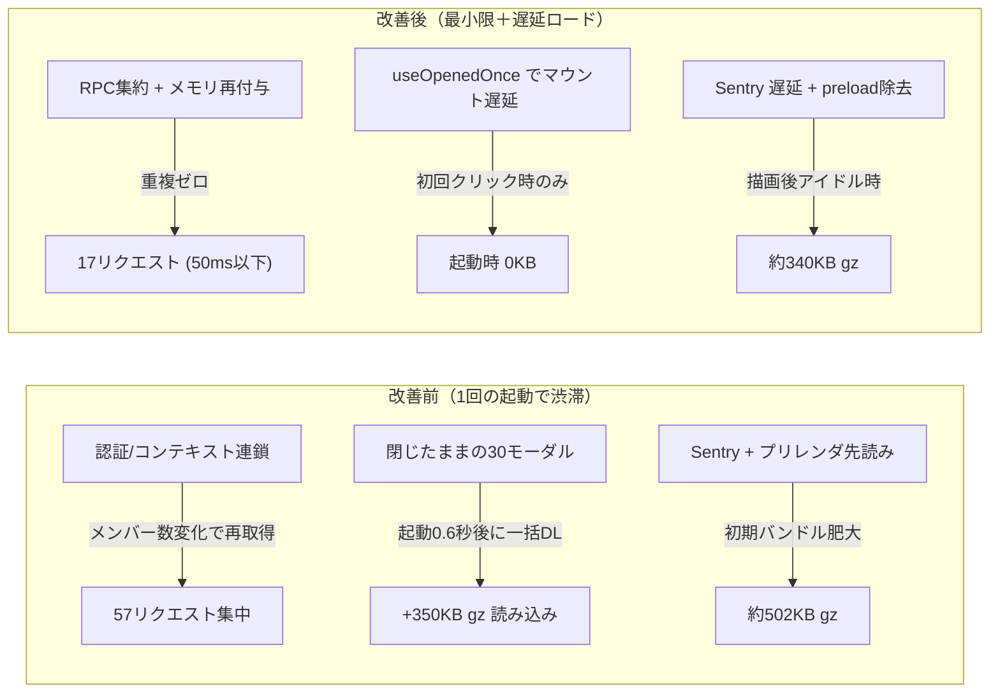

個人開発で Redmine / Backlog 代替のプロジェクト・課題管理 SaaS「[Taski（タスキ）](https://taski-app.com/?utm_source=zenn&utm_medium=article&utm_campaign=14_startup_requests_optimization)」を開発・運用しています。

ある日、ログイン後にプロジェクトを開いたときの通信と本番ログをじっくり見直したところ、**背筋が凍る事実**に気づきました。

- 画面を 1 回開いただけなのに、約 3 秒間に **Supabase へ 44〜57 件のリクエスト**が飛んでいた
- DB のクエリ自体は **8.6ms** なのに、数行しかないテーブルの取得に **中央値 200ms・最大 686ms** かかっていた（同時大量送信による PostgREST 側の順番待ち）
- しかもブラウザは、初回起動時に **約 502KB（gzip）** の JS を読み込んだ直後、開いてもいないモーダル群 **約 350KB（gzip）** まで一斉にダウンロードしていた

本記事では、本番ログの計測から特定した **「SPA × Supabase が遅くなる 5 つの原因」** と、それを地道に潰して **初回 57 件 → 17 件・切替時 50ms 以下・起動 JS 大幅削減** を達成するまでの全記録を共有します。

---

## 全体像：Before / After で何を変えたか

最初に改善前後の構造を整理します。



---

## 1. 犯人①：`useEffect` 連鎖による重複リフェッチ地獄（同じデータを最大 9 回取得）

本番ログの内訳を集計すると、57 件のリクエストのうち **約半分が同じテーブルの重複取得** でした。

- メンバー一覧：9 回
- 活動ログ：8 回
- チケット一覧：6 回
- Wiki ページ：4 回

### なぜ起きていたのか？
犯人は React の `useEffect` と `useCallback` の依存配列でした。

1. `DataContext` が「メンバー一覧の件数（`allMembersCount`）」を `useEffect` の依存に入れていたため、起動中にメンバーが増減するたびに **チケット・コメント・活動ログ・Wiki を丸ごと再取得** していた。
2. プロジェクトメンバーを取得する `refreshMembers`（`useCallback`）の依存に `authAllMembers` や `enabled_modules` 等が入っていたため、状態が少し変わるたびにメンバー一覧を取り直していた。
3. さらに起動時にログイン中であっても、`AuthContext` が使わない全ユーザープロフィール取得まで走らせていた。

### 解決策：再取得せず「手元のデータへ付け直す」
メンバーの名前や担当色が変わったからといって、チケット本体まで DB から取り直す必要はありません。
`refreshData()` のトリガーは **プロジェクト ID・ユーザー ID の変更のみ** に絞り、メンバー一覧が後から読み込まれたり色が変更されたりした場合は、すでにメモリ上にある `tickets` / `commentsMap` / `activitiesMap` / `wikiPages` に **表示情報（担当者・作成者オブジェクト）だけを付け直す** 形へ変更しました。

```tsx
// メンバー情報の変化時は DB へ再問い合わせせず、取得済みデータに付け直す
useEffect(() => {
  const members = allMembersRef.current;
  const findMember = (id?: string | null) =>
    id ? members.find((m) => m.id === id) : undefined;

  setTickets((prev) => (prev.length === 0 ? prev : enrichTicketList(prev, members)));
  setCommentsMap((prev) => {
    const keys = Object.keys(prev);
    if (keys.length === 0) return prev;
    const next: Record<string, TicketComment[]> = {};
    for (const key of keys) {
      next[key] = prev[key].map((c) => ({ ...c, author: findMember(c.user_id) ?? c.author }));
    }
    return next;
  });
  // activitiesMap / wikiPages も同様にローカルで再紐付け
}, [membersSignature, enrichTicketList]);
```

また `ProjectContext` 側のメンバー再取得も、本当に結果が変わりうるキー（プロジェクト切替・保存済み担当色・自分のプロフィール変更など）のみを依存配列に並べ、無駄なリフェッチをゼロにしました。

---

## 2. 犯人②：設定テーブル 10 種類の個別リクエスト → `SECURITY INVOKER` RPC 1 発へ

Taski ではプロジェクトを開くたびに、以下の 10 種類の設定テーブルをそれぞれ別の API リクエストで取得していました。

1. 仮メンバー（`project_placeholder_members`）
2. GitHub 連携リポジトリ（`project_github_repos`）
3. 定期タスク設定（`ticket_recurrence_rules`）
4. ステータス定義（`project_statuses`）
5. チーム一覧 ＋ 所属メンバー（`project_teams`）
6. タグ（`project_tags`）
7. マイルストーン（`project_milestones`）
8. 休日設定（`project_holidays`）
9. カスタムフィールド（`project_custom_fields`）
10. Webhook 設定（`project_webhooks`）

どれも数件〜数十件しか入っていない小さなテーブルですが、起動直後に 10 本以上を並列で投げるため、サーバー側でキュー待ちが発生していました。

### 解決策：RLS を壊さずに 1 往復へまとめる RPC
PostgreSQL 関数 `get_project_settings(target_project_id uuid)` を作成し、10 テーブルを `jsonb_build_object` でまとめて 1 回の RPC 呼び出しで返すようにしました。

ポイントは **`SECURITY INVOKER`** を指定することです。`SECURITY DEFINER` にしてしまうと RLS をバイパスして権限制御を自前で書き直すリスクが生じますが、`SECURITY INVOKER` なら **呼び出し元ユーザーの RLS が従来どおりそのまま効きます**。

```sql
CREATE OR REPLACE FUNCTION public.get_project_settings(target_project_id uuid)
RETURNS jsonb
LANGUAGE sql
STABLE
SECURITY INVOKER
SET search_path = public
AS $$
  SELECT jsonb_build_object(
    'statuses', COALESCE((
      SELECT jsonb_agg(to_jsonb(t) ORDER BY t.order_index)
      FROM public.project_statuses t WHERE t.project_id = target_project_id), '[]'::jsonb),
    'teams', COALESCE((
      SELECT jsonb_agg(
        to_jsonb(t) || jsonb_build_object('member_ids', COALESCE((
          SELECT jsonb_agg(m.user_id) FROM public.project_team_members m WHERE m.team_id = t.id), '[]'::jsonb))
        ORDER BY t.created_at)
      FROM public.project_teams t WHERE t.project_id = target_project_id), '[]'::jsonb),
    -- ほか 8 テーブルも同様に集約
  );
$$;
```

アプリ側は、まず `supabase.rpc('get_project_settings', ...)` を呼び出し、エラー（マイグレーション未適用環境など）の場合だけ従来の個別取得へフォールバックする構成にしました。これで **10〜13 件のリクエストが 1 件** に減りました。

---

## 3. 犯人③：Wiki 本文の一括取得（遅延ロード化）と 2 フェーズ描画

チケットから Wiki ページを参照・プレビューする機能を追加した際、**「プロジェクト切替時に `wiki_pages` の `content`（長文 Markdown）まで全ページ分一括取得していた」** ことも負荷になっていました。

一覧やタイトル補完（`[[ページ名]]`）の段階では、本文 `content` は一切不要です。

- **プロジェクト切替時**: `id, project_id, parent_id, title, created_by, updated_by, created_at, updated_at` の軽量カラムのみを取得（`contentLoaded: false`）。
- **ページ閲覧・プレビュー・編集時**: `fetchWikiPageContent(id)` を呼び出し、該当ページ 1 件の `content` だけを遅延取得する。

さらに、複数の場所（サイドバーやチケット内プレビューなど）から同じ Wiki ページが同時に要求されても二重通信しないよう、`Map<string, Promise<string | null>>` でインフライト中の Promise を共有しています。

```ts
const wikiContentFetchInFlightRef = useRef<Map<string, Promise<string | null>>>(new Map());

const fetchWikiPageContent = async (id: string): Promise<string | null> => {
  const target = wikiPages.find((w) => w.id === id);
  if (!target) return null;
  if (target.contentLoaded) return target.content;

  const inflight = wikiContentFetchInFlightRef.current.get(id);
  if (inflight) return inflight;

  const promise = (async () => {
    try {
      const { data, error } = await supabase
        .from('wiki_pages')
        .select('content')
        .eq('id', id)
        .single();
      if (error || !data) return null;
      const loadedContent = data.content ?? '';
      setWikiPages((prev) =>
        prev.map((w) => (w.id === id ? { ...w, content: loadedContent, contentLoaded: true } : w))
      );
      return loadedContent;
    } finally {
      wikiContentFetchInFlightRef.current.delete(id);
    }
  })();

  wikiContentFetchInFlightRef.current.set(id, promise);
  return promise;
};
```

あわせてチケット関連データも **フェーズ 1（チケット配列が揃った瞬間に一覧を描画）** → **フェーズ 2（裏で並行開始していたコメント・活動ログ・ウォッチャー等を後から反映）** の 2 段階に分けており、数千件規模のプロジェクトでも一覧表示を待たせない仕組みにしています。

---

## 4. 犯人④：`React.lazy` なのに起動 0.6 秒後に約 350KB 読み込まれていた理由

コード分割のために、設定モーダルやインポートモーダルなど約 30 個の重いモーダルはすべて `React.lazy()` で定義していました。にもかかわらず、ネットワークタブを見ると起動直後に約 350KB（gzip）ものチャンクが一斉に読み込まれていました。

### 原因：`isOpen={false}` でも JSX に書いていればマウントされる
```tsx
// これだと isSettingsOpen === false でも、初回レンダー時に React がコンポーネントを解決し、
// lazy の import() が発火して全モーダルのチャンクが一斉にダウンロードされてしまう
<React.Suspense fallback={null}>
  <SettingsModal isOpen={isSettingsOpen} onClose={() => setIsSettingsOpen(false)} />
</React.Suspense>
```

### 解決策：`useOpenedOnce` フック（13 行）
かといって単純に `{isSettingsOpen && <SettingsModal />}` にすると、閉じた瞬間にアンマウントされて入力途中の状態が消えたり、閉アニメーションが効かなくなったりします。

そこで **「一度でも開かれたら `true` を返し続ける」** だけの小さなカスタムフック [`useOpenedOnce`](https://github.com/satomo14/taski/blob/main/src/hooks/useOpenedOnce.ts) を作りました。

```ts
import { useState } from 'react';

export const useOpenedOnce = (open: boolean): boolean => {
  const [opened, setOpened] = useState(open);
  if (open && !opened) setOpened(true);
  return opened || open;
};
```

```tsx
const settingsOpened = useOpenedOnce(isSettingsOpen);

return (
  <React.Suspense fallback={null}>
    {settingsOpened && (
      <SettingsModal isOpen={isSettingsOpen} onClose={() => setIsSettingsOpen(false)} />
    )}
  </React.Suspense>
);
```

たったこれだけで、**使う人しか開かない重い設定画面や CSV インポート画面の JS チャンク約 350KB が、起動時に一切読み込まれなくなりました。** 一度開いた後はマウントされたままなので、次回開くときも快適で入力状態も保持されます。

---

## 5. 犯人⑤：Sentry 163KB（gzip）と「プリレンダリングが `modulepreload` を復活させる罠」

初期バンドルの約 502KB（gzip）のうち、エラー監視の `@sentry/react` だけで **約 163KB（gzip）** を占めていました。

そこで `requestIdleCallback` を使って「初回表示が終わってから Sentry を動的 `import('@sentry/react')` する」ラッパーを作成し、読み込み前エラーだけはメモリ配列に溜めておくようにしました。

```ts
// src/lib/monitoring.ts（抜粋）
export const initMonitoring = (options: SentryInitOptions) => {
  const earlyErrors: unknown[] = [];
  const onError = (event: ErrorEvent) => earlyErrors.push(event.error ?? event.message);
  const onRejection = (event: PromiseRejectionEvent) => earlyErrors.push(event.reason);
  window.addEventListener('error', onError);
  window.addEventListener('unhandledrejection', onRejection);

  const load = () => {
    import('@sentry/react').then((mod) => {
      mod.init(options);
      window.removeEventListener('error', onError);
      window.removeEventListener('unhandledrejection', onRejection);
      sentry = mod;
      earlyErrors.splice(0).forEach((error) => mod.captureException(error));
      pendingCalls.splice(0).forEach((fn) => fn(mod));
    });
  };

  if ('requestIdleCallback' in window) {
    window.requestIdleCallback(load, { timeout: 4000 });
  } else {
    setTimeout(load, 2000);
  }
};
```

**……ところが、ここで思わぬ罠にハマりました。**
デプロイ後の本番 HTML の `<head>` を確認すると、なぜか `<link rel="modulepreload" href="/assets/vendor-sentry-xxx.js">` がしっかり書き込まれており、結局起動時にダウンロードされていたのです。

### 原因：静的プリレンダリングが「アイドル後の DOM」を保存していた
Taski では、Vite でビルドした後にヘッドレスブラウザで LP 等を静的 HTML 化するプリレンダリング処理（`scripts/prerender.js`）を走らせています。
プリレンダリングはネットワークが落ち着く（`networkidle0`）まで待ってから `document.documentElement.outerHTML` を保存するため、その待機中にブラウザ上の `requestIdleCallback` が発火し、Vite のランタイムが動的に挿入した `modulepreload` タグまで本番 HTML に焼き付けられてしまっていたのです。

### 解決策：プリレンダリング出力時に遅延対象チャンクの `modulepreload` を剥がす
ビルドスクリプト側で、遅延ロード対象チャンクの `modulepreload` タグを正規表現で取り除く処理を 1 枚噛ませることで完全に解決しました。

```js
const DEFERRED_CHUNK_PATTERNS = [/\/assets\/vendor-sentry-[^"]+\.js/];

function stripDeferredPreloads(html) {
  return html.replace(/<link\b[^>]*rel="modulepreload"[^>]*>/g, (tag) =>
    DEFERRED_CHUNK_PATTERNS.some((re) => re.test(tag)) ? '' : tag
  );
}
```

---

## 本番環境での実測結果（ログ比較）

同じユーザーアカウントで本番環境へログイン・プロジェクト表示・切り替えを行った際の、修正前後の実測比較です。

| 計測項目 | 修正前 | 修正後 |
|---|---|---|
| 初回読み込みリクエスト数 | **57 件** | **17 件** |
| 400 エラー件数（不要/誤カラム取得等） | **5 件** | **0 件** |
| 同一データの重複取得 | メンバー 9 回 / 活動 8 回 / チケット 6 回 / Wiki 4 回 | **すべて 1 回のみ** |
| プロジェクト設定 10 種の取得 | 10〜13 件（個別クエリ） | **1 件**（`get_project_settings` RPC） |
| 応答時間（平均・最大） | 平均 124ms / 最大 686ms（PC） | 初回最大 466ms（モバイル回線） / **切替後は 10〜50ms** |
| 起動時必須 JS ペイロード（gzip） | 約 **502KB** | 約 **340KB**（Sentry 163KB 分を遅延化） |
| 起動直後の非表示モーダルチャンク | 約 **350KB** 一括読込 | **0KB**（実際に開くまで読み込まない） |

### 副次的な発見：本番ログを見て見つかった 400 エラー
今回すべてのリクエストログを精査したことで、別の不具合（`project_members.color` カラム未追加による 400 エラーや、API 側が初期ステータス取得時に存在しない `order_num` でソートして毎回デフォルト `'open'` にフォールバックしていたバグ）も同時に見つけて潰すことができました。

---

## おわりに：実際に触って体感してみてください

「初期リクエストを 1/3 以下に減らし、2 フェーズ描画や Wiki 本文の遅延ロードを取り入れた状態がどのくらいサクサク動くのか」は、Taski の **登録不要・1 秒お試しデモ** でそのまま体験できます。

ぜひ実際に触ってみて、チケット一覧の切り替えや、チケット詳細から `[[Wiki名]]` プレビューを開いたときのレスポンスを体感してみてください。

👉 **[Taski デモ環境を今すぐ試す（登録不要）](https://taski-app.com/?demo=true&utm_source=zenn&utm_medium=article&utm_campaign=14_startup_requests_optimization)**

