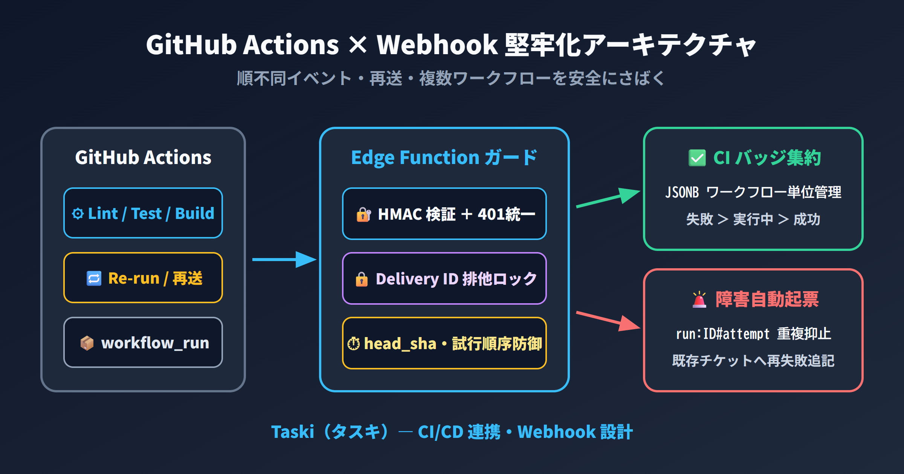
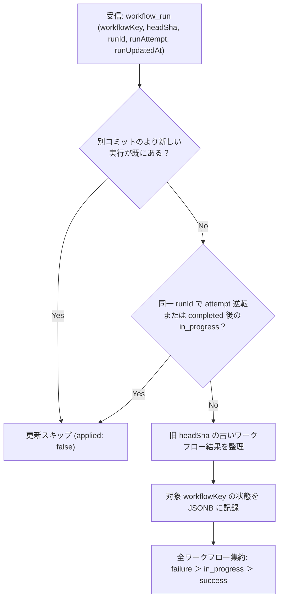
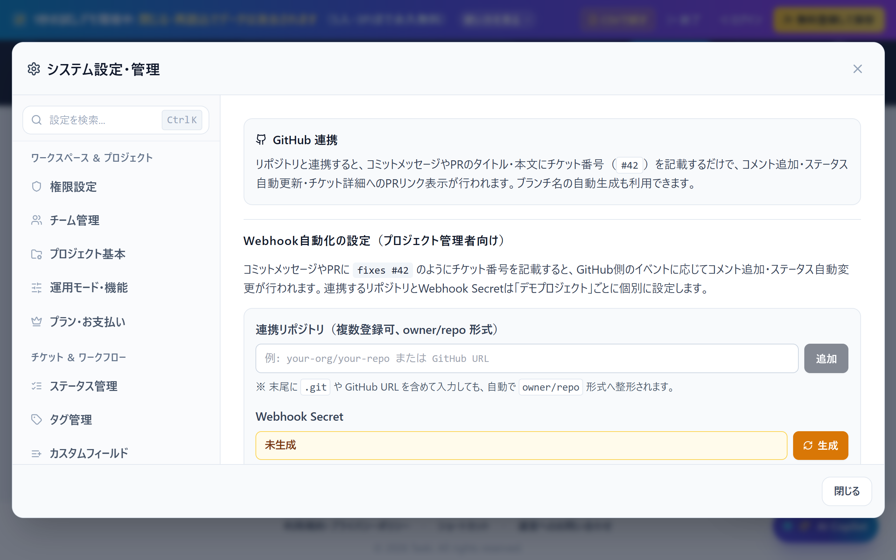

個人開発で Redmine / Backlog 代替のプロジェクト・課題管理 SaaS「[Taski（タスキ）](https://taski-app.com/?utm_source=zenn&utm_medium=article&utm_campaign=15_github_actions_ci_webhook)」を開発・運用しています。

開発チーム向けのタスク管理ツールを作っていると、**「GitHub Actions が落ちた瞬間に自動で障害チケットを起こし、関連チケットのカンバンカード上にも CI ステータスをリアルタイム表示したい」** というニーズに必ず行き当たります。

一見すると「`workflow_run` Webhook を受け取って `tickets` テーブルを `INSERT` / `UPDATE` するだけ」に思えます。しかし、いざ本番品質で作り込むと、**並列実行・順不同配信・Re-run（再試行）・マルチテナントのセキュリティ** など、泥臭い落とし穴が次々と出てきました。

本記事では、Supabase Edge Functions（Deno）＋ PostgreSQL（JSONB）＋ React で構築した **「壊れない GitHub Actions Webhook 連携」の設計と実装パターン** を共有します。

---

## 全体像：Webhook 1本で「バッジ同期」と「障害自動起票」をさばく

最初に全体のアーキテクチャを整理します。Taski では全プロジェクト共通の 1 エンドポイント（`github-webhook` Edge Function）でイベントを受信し、検証と順序防御を通過したものだけを DB へ反映しています。



この設計に行き着くまでに潰した **4 つの落とし穴** を、実際のコードとともに解説します。

---

## 落とし穴①：単一カラム上書きだと「並列ワークフロー」と「順不同配信」で状態が壊れる

最初にやりがちなのが、`tickets.github_ci_status`（`'in_progress' | 'success' | 'failure'`）に Webhook の結果をそのまま上書きする実装です。これには 2 つの致命的なバグが潜んでいます。

1. **複数ワークフローの衝突**: `Lint` と `Test` が並列で走るリポジトリで、`Lint` が失敗（`failure`）した 3 秒後に `Test` が成功（`success`）すると、**まだ直っていないのにバッジが緑（`CI Passed`）に塗り替わってしまう**。
2. **Webhook の順不同・遅延到着**: 処理が速く終わって `completed (success)` が届いたあとに、ネットワーク遅延で遅れていた `in_progress` イベントが到着すると、**完了したはずのバッジが一生スピナー（`CI Running...`）に戻ってしまう**。

### 解決策：`github_ci_workflows`（JSONB）でワークフロー単位に保持＋3段階の順序防御

`tickets` テーブルに `github_ci_workflows`（JSONB）を追加し、ワークフローキー（`workflowId || workflowName`）ごとにステータス・`runId`・`runAttempt`・`headSha`・`runUpdatedAt` を保持するようにしました。

状態計算関数 `computeNextTicketCiState()` では、次の順番で古いイベントを弾いたうえで全体を集約します。



実際の判定ロジック（`supabase/functions/github-webhook/workflowFailure.ts` 抜粋）は次の通りです。

```typescript
// 1. すでに別コミット (新しい headSha) の新しい実行が記録されている場合は遅延イベントを無視
if (ciUpdate.headSha && incomingMs !== null) {
  for (const entry of Object.values(nextMap)) {
    if (entry.headSha && entry.headSha !== ciUpdate.headSha) {
      const entryMs = getEntryTimestampMs(entry);
      if (entryMs !== null && entryMs > incomingMs) {
        return { ...currentFallback, github_ci_workflows: nextMap, applied: false };
      }
    }
  }
}

// 2. 同一ワークフロー内の順不同配信・古い再送を拒否
const prev = nextMap[ciUpdate.workflowKey];
if (prev && prev.runId !== null && ciUpdate.runId !== null && prev.runId === ciUpdate.runId) {
  if (ciUpdate.runAttempt < prev.runAttempt) {
    ignoreUpdate = true;
  } else if (ciUpdate.runAttempt === prev.runAttempt) {
    // completed (success/failure) 到達後に同一試行の in_progress が遅延到着しても上書きしない
    if ((prev.status === 'success' || prev.status === 'failure') && ciUpdate.ciStatus === 'in_progress') {
      ignoreUpdate = true;
    } else if (prevMs !== null && incomingMs !== null && incomingMs < prevMs) {
      ignoreUpdate = true;
    }
  }
}
```

さらに、全ワークフローを集約する際は **`failure > in_progress > success`** の優先度で代表ステータスとリンク先 URL（失敗があれば失敗中のログ URL）を決定します。

:::message
**共有ブランチでの誤爆防止**
PR URL に紐づかない `main` / `master` / `develop` / `staging` / `production` といった共有ブランチの実行は、無関係なチケットへ CI バッジを付けてしまわないよう、`SHARED_BRANCH_NAMES` としてブランチ名一致の対象から除外しています（失敗時の障害チケット自動起票だけは行います）。
:::

---

## 落とし穴②：CI が落ちるたびにチケットが無限増殖する（＆ Re-run を見落とす）

`workflow_run` の `action === 'completed'` かつ `conclusion` が `'failure'` または `'timed_out'` のときに毎回新規チケットを `INSERT` すると、同じブランチで修正をプッシュするたびに `[CI障害]` チケットが量産されてしまいます。

### 解決策：未完了チケットへの追記集約 ＋ `run:ID#attempt` による厳密な重複排除

1. まず同一プロジェクト・同一ブランチ（`github_branch_name`）で `[CI障害] ` から始まる未完了チケットを検索し、同じワークフロー（本文の `wf:${workflowId}` またはタイトルプレフィックス）が開いていれば**新規起票せずコメントとして再失敗を追記**します。
2. 次に「Webhook の再送で同じ再失敗コメントが二重に付く」問題を防ぐため、本文とコメントに **`run:${runId}#${runAttempt}`** という実行識別子を埋め込みます。

ここで重要なのが **`runAttempt` を必ず含めること** です。GitHub Actions で「Re-run failed jobs」を実行すると、**`run_id` や `html_url` は前回の失敗と同じまま、`run_attempt` だけが `1` → `2` に増えます**。もし `html_url` の一致だけで重複判定していると、2 回目の再失敗（Re-run）まで「重複」とみなして記録を落としてしまいます。

```typescript
export function formatWorkflowFailureRunTag(runId: number | null, runAttempt = 1): string {
  return runId !== null ? `run:${runId}#${runAttempt}` : '';
}

export function isSameWorkflowFailureRun(
  ticketDescription: string | null | undefined,
  existingComments: Array<{ content?: string | null }> | null | undefined,
  draft: WorkflowFailureTicketDraft,
): boolean {
  const texts = [ticketDescription, ...(existingComments ?? []).map((c) => c?.content)]
    .filter((t): t is string => typeof t === 'string' && t.length > 0);

  const runTag = formatWorkflowFailureRunTag(draft.runId, draft.runAttempt);
  if (runTag) {
    if (texts.some((text) => text.includes(runTag))) {
      return true;
    }
    // すでに別 attempt の run:ID# が記録されている、または attempt >= 2 なら URL フォールバックしない
    const runPrefix = `run:${draft.runId}#`;
    if (draft.runAttempt > 1 || texts.some((text) => text.includes(runPrefix))) {
      return false;
    }
  }

  return Boolean(draft.runUrl && texts.some((text) => text.includes(draft.runUrl)));
}
```

---

## 落とし穴③：マルチテナント単一エンドポイントでの衝突と「情報オラクル」

GitHub Webhook の受け口 URL を全プロジェクト共通の 1 本にしている場合、受信した JSON の `repository.full_name`（例: `Owner/Repo`）から対象プロジェクトを特定し、プロジェクト固有の Webhook Secret で `X-Hub-Signature-256` を検証します。

ここで初期に踏んだ設計ミスが 3 つありました。

1. **グローバル `UNIQUE (repo)` 制約**: 同じ組織内の別プロジェクト（例: フロント用 PJ とバックエンド用 PJ）で同じリポジトリを連携しようとすると DB 制約で弾かれる。
2. **大文字・小文字の表記揺れ**: ユーザーが `MyOrg/MyRepo` と登録したのに GitHub 側の表記や入力が `myorg/myrepo` だと一致しない。
3. **情報オラクル（Enumeration）**: 「リポジトリ未連携なら `404`、署名不一致なら `401`」と返すと、未認証の第三者が `repository.full_name` を変えて叩くだけで **「どのリポジトリが Taski に登録済みか」を列挙できてしまう**。

### 解決策：`UNIQUE (project_id, lower(repo))` ＆ 候補プロジェクト全件での署名検証

DB 側ではグローバル一意制約を廃止し、プロジェクト単位かつ小文字正規化の複合ユニークインデックスへ移行しました（`supabase/github_webhook_reliability_setup.sql`）。

```sql
ALTER TABLE public.project_github_repos
DROP CONSTRAINT IF EXISTS project_github_repos_repo_key;

CREATE UNIQUE INDEX IF NOT EXISTS project_github_repos_project_repo_lower_idx
ON public.project_github_repos (project_id, lower(repo));

CREATE INDEX IF NOT EXISTS project_github_repos_repo_lower_idx
ON public.project_github_repos (lower(repo));
```

Edge Function 側では次のように処理します。

- `ilike` + JS 側 `.toLowerCase()` で候補プロジェクトを複数取得
- 各候補に紐づく Secret（クライアントから読めない専用テーブル `project_github_webhook_secrets`）で `crypto.subtle` による HMAC-SHA256 + timing-safe 比較を実行し、**署名が一致したプロジェクトだけを通す**
- 未登録も署名不一致もすべて同じ **`401 Unauthorized`** を返す

---

## 落とし穴④：リプレイ・同時配信レースと、Bot 起票時の `NOT NULL` 制約

### 1. `X-GitHub-Delivery` による処理前排他ロック
同時配信レースやリプレイ攻撃を防ぐため、署名検証とプラン判定を通過した直後に `X-GitHub-Delivery` ヘッダを `github_webhook_deliveries` テーブルへ `INSERT` します。

- 一意制約違反（PostgreSQL エラーコード `23505`）ならすでに別リクエストが処理中または処理済みなので `200 OK (skipped)` で即終了
- 処理中に DB エラー等で失敗した場合は `catch` ブロックで `delivery_id` のロック行を `DELETE` してから `500` を返し、GitHub 側のリトライを受け入れられるようにする
- 通知テーブルへの `INSERT` やアクティビティログ記録といった**非冪等な副作用は、すべてのチケット更新・起票が成功したあとの最後**に実行する

### 2. Bot 自動起票と `NOT NULL` 制約（`23502`）
人が画面から起票する場合は `created_by` や `comments.user_id` にユーザー ID が入りますが、Webhook による自動起票では実行ユーザーが存在しないことがあります。
マイグレーションで `created_by` / `user_id` を NULL 許容化しつつ、万一マイグレーション未適用の環境で `23502`（NOT NULL 違反）が返った場合でも落ちないよう、プロジェクト作成者や最古メンバーへフォールバックする防御コードを入れています。

---

## UI 表示とセキュリティ対策（`GithubCiBadge`）

フロントエンド側では、カンバンカード（コンパクト表示：`CI OK` / `CI NG` / `CI中`）とチケット一覧・詳細（フル表示：`CI Passed` / `CI Failed` / `CI Running...`）で共通コンポーネント `GithubCiBadge` を描画しています。

Webhook 由来の `github_ci_url` をそのまま `<a href>` に渡すのは危険なため、必ず `https://github.com/` 始まりの URL のみを許可するサニタイズを通してからリンク化しています。

```tsx
export function sanitizeGithubCiUrl(url?: string | null): string | null {
  if (!url || typeof url !== 'string') return null;
  const trimmed = url.trim();
  if (/^https:\/\/github\.com\/[^\s]+$/i.test(trimmed)) {
    return trimmed;
  }
  return null;
}
```

設定画面の「GitHub 連携」タブも、`owner/repo` 自動整形や Webhook Secret のワンクリック生成・再発行を含め、プロジェクト単位で完結できるように設計しました。



### Vitest によるロジックとコンポーネントの自動検証

Edge Function の純粋ロジック（`workflowFailure.ts`）は Deno / Supabase SDK から切り離して書いているため、フロントエンドと同じ Vitest で境界ケース（並列失敗・順不同 `in_progress`・`run_attempt` 増加・`javascript:` URL 拒否）を自動テストできています。

```text
 ✓ src/lib/__tests__/githubWorkflowFailure.test.tsx (9 tests) 70ms

 Test Files  1 passed (1)
      Tests  9 passed (9)
```

---

## まとめ

GitHub Actions の Webhook 連携は、Happy Path だけなら半日で作れますが、運用で壊れないようにするには以下の設計が効いてきます。

- **ワークフロー単位の JSONB 集約**＋`headSha` / `runAttempt` / 完了後ガードによる順不同防御
- **`run:ID#attempt` 識別子**で Re-run を落としつつ重複起票・重複コメントを防ぐ
- **候補プロジェクト単位の署名検証＋`401` 統一**でマルチテナント衝突と情報オラクルを防ぐ
- **`X-GitHub-Delivery` 排他ロック**と副作用の後回しでリトライ安全性を確保する

同じように Supabase Edge Functions で GitHub Webhook を扱う方の参考になれば幸いです。

---

### Taski のデモ環境で UI・ワークフローを体験できます

本記事で紹介した GitHub 連携の設定画面や、カンバンボード・チケット一覧・ガントチャートなどのタスク管理体験は、**登録不要・1 秒で起動するデモ環境** でそのまま触って確認できます。

👉 **[Taski（タスキ）のデモ環境をブラウザで試す（登録不要）](https://taski-app.com/?demo=1&utm_source=zenn&utm_medium=article&utm_campaign=15_github_actions_ci_webhook)**
