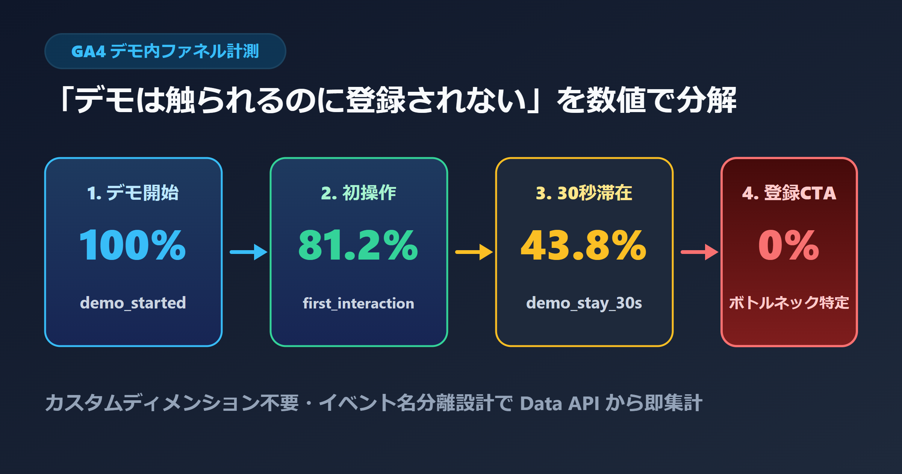
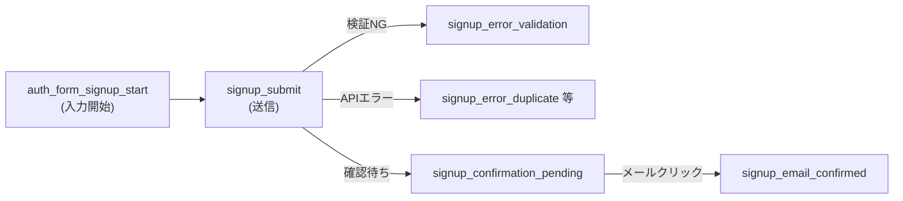

個人開発で Redmine / Backlog 代替のプロジェクト・課題管理 SaaS「[Taski（タスキ）](https://taski-app.com/?utm_source=zenn&utm_medium=article&utm_campaign=16_ga4_demo_funnel)」を開発・運用しています。

Taski の LP には **「登録不要・1秒で起動するデモ環境」** を用意しています。ありがたいことに訪問者のうちデモを起動してくれる割合は高く、**「まず触ってもらう」** ところまでは順調でした。

しかし、ある日 GA4 を見るとこんな状態になっていました。

- デモ開始（`demo_started`）: **毎月十数人以上が触っている**
- デモ内の登録ボタンクリック: **0 件**
- 新規登録（`sign_up`）: **ほぼ 0 件**

**「なぜデモは触られているのに、誰一人として本登録に進まないのか？」**

GA4 の標準イベント（`page_view` や `form_start`）だけでは、デモ画面に入ったあとのユーザーの行動は完全にブラックボックスでした。そこで本記事では、**カスタムディメンション登録に頼らず GA4 Data API だけで即座にファネルを分解できるイベント設計** と、**実測で見えた残酷な現実（初操作 81.2% なのに CTA クリック 0 件）および計測漏れの特定記録** を共有します。

---

## 1. 全体像：ブラックボックスだった「デモ内ファネル」を6段階に分解する

最初に設計した計測フローの全体像です。



「デモに入ったのに登録されない」という 1 つの事象を、次の 6 つの問いに分解しました。

1. **操作しているのか？**（開いてすぐ閉じただけか、触っているか）
2. **どれくらい滞在しているのか？**（タブを裏に開いたまま放置していないか）
3. **登録導線は画面に出ているのか？**（「押されない」のか「そもそも見られていない」のか）
4. **どこで離脱しようとしたのか？**（ヘッダーの「終了」を押したのか）
5. **フォームを開いたあと、どこで詰まったのか？**（登録とログインのどちらで、何のエラーか）
6. **リダイレクト直前の送信が欠測していないか？**

---

## 2. 設計上の工夫①：GA4 Data API で即分解するために「イベント名」を分ける

GA4 をアプリから叩いてイベントを送るとき、多くの解説記事では次のような実装が紹介されます。

```typescript
// ❌ 後から Python / Data API で分解しようとすると詰まりやすい例
gtag('event', 'compare_cta_click', {
  page: 'backlog',
  action: 'demo',
});
```

これ自体は正しいのですが、GA4 は **イベントパラメータ（`page` や `action`）を管理画面で「カスタムディメンション」として事前登録しないと、Data API のレポートで集計・分解できません**。しかも登録後に溜まったデータからしか有効にならず、個人開発のスピード感で「今日入れた計測を明日スクリプトで確認する」ときに足枷になります。

そこで Taski（`src/lib/analytics.ts`）では、**「パラメータも送るが、Data API で一発で引きたい軸はイベント名自体を分ける」** という割り切り設計を採用しました。

```typescript
// src/lib/analytics.ts より抜粋
export type ComparePageId = 'backlog' | 'redmine' | 'jira' | 'asana' | 'trello';
export type CompareCtaAction = 'demo' | 'signup';

/** 比較ページのデモ開始ボタン・登録ボタンがクリックされた */
export function trackCompareCtaClick(page: ComparePageId, action: CompareCtaAction): void {
  trackEvent('compare_cta_click', { page, action });
  // カスタム定義なしで Data API からそのまま集計できるようイベント名を分離
  trackEvent(`compare_cta_${page}_${action}`);
}
```

### 登録／ログインフォームのエラー種別もイベント名で分離

同じ理由で、GA4 自動計測の `form_start` にも罠がありました。`form_start` は **「新規登録フォーム」と「ログインフォーム」を区別できず、どのエラーで止まったかも分かりません**。

そこで Supabase Auth のエラーメッセージを正規化し、イベント名自体を分けて送信しています。

```typescript
// src/lib/analytics.ts より抜粋
export type AuthErrorKind =
  | 'duplicate'
  | 'password'
  | 'network'
  | 'unconfirmed'
  | 'credentials'
  | 'other';

export function classifyAuthError(rawMessage: string): AuthErrorKind {
  const m = rawMessage || '';
  if (m.includes('User already registered')) return 'duplicate';
  if (m.includes('Password should be') || m.includes('weak password')) return 'password';
  if (m.includes('Email not confirmed')) return 'unconfirmed';
  if (m.includes('Invalid login credentials')) return 'credentials';
  if (m.includes('Failed to fetch') || m.includes('NetworkError') || m.includes('fetch')) return 'network';
  return 'other';
}

export const trackSignupSubmit = () => trackEvent('signup_submit');
export const trackSignupError = (kind: AuthErrorKind) => trackEvent(`signup_error_${kind}`);
```



これにより、Python スクリプト（`scripts/ga4_report.py`）から `eventName` を取得するだけで、カスタムディメンション設定ゼロで即座に離脱ポイントが一覧できるようになりました。

---

## 3. 設計上の工夫②：1訪問1回のガードと `visibilityState`、そして `sendBeacon`

デモ内の計測は、ノイズが混ざるとすぐに実態が歪みます。特に気をつけたのは次の 3 点です。

### ① 初操作・露出イベントは「1訪問につき1回」に厳密制御

ユーザーがカンバンカードを 10 回ドラッグするたびに `demo_first_interaction` が飛ぶと、人数と件数の比率が壊れます。`sessionStorage` とメモリ上の `Set` を併用して 1 セッション 1 回に抑えています。

```typescript
let hasTrackedDemoFirstInteraction = false;

export function trackDemoFirstInteraction(action: string = 'general'): void {
  if (hasTrackedDemoFirstInteraction) return;
  try {
    if (sessionStorage.getItem('taski_demo_first_interaction')) {
      hasTrackedDemoFirstInteraction = true;
      return;
    }
    sessionStorage.setItem('taski_demo_first_interaction', 'true');
  } catch {
    // ignore storage error
  }
  hasTrackedDemoFirstInteraction = true;
  trackEvent('demo_first_interaction', { action });
}

const firedDemoOnce = new Set<string>();
function trackDemoOnce(name: string): void {
  if (firedDemoOnce.has(name)) return;
  firedDemoOnce.add(name);
  trackEvent(name);
}
```

### ② 滞在秒数（30秒・120秒）は「タブが前面に出ている時間」だけ測る

バックグラウンドタブに放置されたまま 120 秒経っても「デモを熱心に見ていた」とは言えません。`document.visibilityState === 'visible'` の間だけカウントを進め、`demo_stay_30s` / `demo_stay_120s` を発火させます。

### ③ 外部決済リダイレクト直前は `transport_type: 'beacon'` を使う

デモとは別に Stripe Checkout へ遷移する瞬間など、直後に `window.location.href` でページを離脱する処理では、通常の `fetch` / XHR だと通信がキャンセルされて欠測します。`transport_type: 'beacon'` を指定して `navigator.sendBeacon` に切り替えています。

```typescript
export const trackCheckoutRedirect = (interval: 'month' | 'year') =>
  trackEvent('checkout_redirect', { interval, transport_type: 'beacon' });
```

---

## 4. 実測結果：初操作 81.2% なのに、登録CTAクリック 0 件という現実

この計測を仕込んで直近 30 日間（2026年10月下旬〜11月下旬）のデータを `ga4_report.py` で集計した結果がこちらです。

```text
直近30日のデモ内ファネル（件数 / 人数）

  1. デモ開始（登録不要・LP等）                     23 件 /   16 人  (100.0% ← デモ開始比)
  1b. 30秒以上とどまった（前面表示のみ）              10 件 /    7 人  (43.8% ← デモ開始比)
  1c. 120秒以上とどまった                            3 件 /    3 人  (18.8% ← デモ開始比)
  2. 初操作（カード移動・タブ切替・編集等）            21 件 /   13 人  (81.2% ← デモ開始比)
  2b. 「変更を反映」トースト表示                      1 件 /    1 人  (6.2% ← デモ開始比)
  2c. 右下ウィジェット展開表示                       15 件 /    9 人  (56.2% ← デモ開始比)
  3a. 上部バー「無料登録して保存」クリック              0 件 /    0 人  (0.0% ← デモ開始比)
  3b. 右下ウィジェット保存クリック                    0 件 /    0 人  (0.0% ← デモ開始比)
  3c. ヘッダー「終了」クリック（離脱試行）              4 件 /    3 人  (18.8% ← デモ開始比)
  4. 登録モーダル表示（各導線合計）                    0 件 /    0 人  (0.0% ← デモ開始比)
```

数字を並べてみた瞬間、仮説が完全に覆りました。

1. **「触ってもらえていない」のではなかった（初操作率は 81.2%）**
   デモに入った 16 人のうち 13 人が、実際にカードを動かしたりタブを切り替えたりしています。さらに右下ウィジェットも 56.2%（9 人）に表示されており、**「見られていない」わけでもありませんでした**。
2. **30秒〜120秒で満足して離脱し、登録ボタンが 1 度も押されていない**
   初操作のあと、30秒滞在が 43.8%、120秒滞在が 18.8% と急降下し、上部バーも右下ウィジェットもクリック数は **0 件**。代わりにヘッダーの「終了」ボタン（`demo_exit_click`）が 3 人から押されていました。
3. **さらに「1クリックサンプルCSV体験」の計測漏れまで発覚**
   「手元に CSV がない人のために」と用意していた「RedmineサンプルCSVを1クリックで投入」ボタン（`onInstantLoadSampleCsv`）を調査したところ、モーダル経由の `DemoCsvImportModal.tsx` にしか `trackDemoCsvImported()` が入っておらず、1クリック導線側のイベントが未接続だったことまで分かりました。

---

## 5. 数字が見えたから打てる次の打ち手

感覚で「LP のコピーが悪いのかも？」「ボタンの色が目立たないのかも？」と当てずっぽうで直していたら、ずっと的外れな改修を続けていたと思います。

データから見えた次のアクションは明確です。

- **計測接続**: `onInstantLoadSampleCsv` にも `trackDemoCsvImported()` を接続し、サンプルデータ投入率を正しく観測する。
- **登録導線のタイミングと文脈の変更**: 「ただの無料登録ボタン」を常設するのをやめ、**初操作（81.2%）で手を動かした直後** に「この編集状態・サンプルデータを自分のワークスペースに保存して続きを使う」という**成果物の持ち帰りメリット**として登録モーダルを提示する。

---

## まとめ

- GA4 Data API で素早く仮説検証したい個人開発 SaaS では、**カスタムディメンション待ちを避けてイベント名自体を分離する設計** が圧倒的にラクです。
- **「露出（`shown`）」「初操作（`first_interaction`）」「前面滞在（`stay_30s`）」** を分けて測ることで、「見られていない」のか「触られていない」のか「触ったあとに登録する理由がない」のかを明確に切り分けられます。

この記事で紹介した Taski のデモ画面（登録不要・1秒で起動）は、以下のリンクから実際に触って動作を確かめられます。現在も上記のファネル計測をもとに改善を続けていますので、ぜひ一度試してみてください。

👉 **[Taski デモ環境を今すぐ試す（登録不要）](https://taski-app.com/?demo=1&utm_source=zenn&utm_medium=article&utm_campaign=16_ga4_demo_funnel)**
